<picture>
  <source media="(prefers-color-scheme: dark)" srcset="assets/hero-dark.svg">
  
</picture>

  <a href="https://www.linkedin.com/in/tanvi-sadashiv-3713ba381"><b>LinkedIn</b></a>
  &nbsp;&nbsp;&middot;&nbsp;&nbsp;
  <a href="https://x.com/Tanvi_Sadashiv"><b>X</b></a>
  &nbsp;&nbsp;&middot;&nbsp;&nbsp;
  <a href="https://kuberket.onrender.com"><b>Try KuberKet live</b></a>
  &nbsp;&nbsp;&middot;&nbsp;&nbsp;
  <a href="https://skinkind.skin"><b>skinkind.skin</b></a>

 

### Selected work

  <a href="https://github.com/Stanvi09/KuberKet"><picture><source media="(prefers-color-scheme: dark)" srcset="assets/card-kuberket-dark.svg"></picture></a>
  <a href="https://github.com/Stanvi09/NammaPrayana"><picture><source media="(prefers-color-scheme: dark)" srcset="assets/card-nammaflow-dark.svg"></picture></a>

  <a href="https://github.com/Stanvi09/ColdSync-1"><picture><source media="(prefers-color-scheme: dark)" srcset="assets/card-coldsync-dark.svg"></picture></a>
  <a href="https://github.com/Stanvi09/CropSense"><picture><source media="(prefers-color-scheme: dark)" srcset="assets/card-cropsense-dark.svg"></picture></a>

  <a href="https://github.com/Stanvi09/PlacementAdvisor-app"><picture><source media="(prefers-color-scheme: dark)" srcset="assets/card-placement-dark.svg"></picture></a>
  <a href="https://github.com/Stanvi09/Skinkind"><picture><source media="(prefers-color-scheme: dark)" srcset="assets/card-skinkind-dark.svg"></picture></a>

 

### How I work

| | Principle | Where you can see it |
|:-:|---|---|
| **01** | **Numbers come from code you can test, not from a model's guess.** | In KuberKet, every rupee is computed by a finance engine with 228 tests. The voice AI never does maths. |
| **02** | **Say what the system can't do.** | NammaFlow's README lists its own limits: simulated coaches, "probable" causes, no live BMRCL claims. |
| **03** | **Design for the worst connection, not the demo Wi-Fi.** | CropSense keeps giving advice from on-device sensor data when the disease model is unreachable. |
| **04** | **Understand the layer underneath.** | Placement Advisor has no framework: just sockets, a hand-written HTTP parser and a router, in C. |
| **05** | **The details are the product.** | One set of design tokens in ColdSync, one stylesheet across 35 pages in SkinKind, and tests that stop English leaking into KuberKet's Hindi screens. |

 

### Toolkit

| Area | Tools |
|---|---|
| **Languages** | Python &nbsp;·&nbsp; TypeScript &nbsp;·&nbsp; JavaScript &nbsp;·&nbsp; C &nbsp;·&nbsp; C++ for Arduino / ESP32 |
| **Backend** | FastAPI &nbsp;·&nbsp; Flask &nbsp;·&nbsp; Firebase (Auth, Realtime DB, Firestore) &nbsp;·&nbsp; MQTT &nbsp;·&nbsp; SQLite |
| **Frontend** | React 19 &nbsp;·&nbsp; React Native + Expo &nbsp;·&nbsp; Vite &nbsp;·&nbsp; HTML / CSS by hand |
| **ML** | scikit-learn &nbsp;·&nbsp; quantile regression &nbsp;·&nbsp; interpretable classifiers &nbsp;·&nbsp; image classification |
| **Hardware** | ESP32 &nbsp;·&nbsp; IR break-beam sensors &nbsp;·&nbsp; DS18B20 &nbsp;·&nbsp; soil and climate sensors |
| **Practice** | pytest &nbsp;·&nbsp; Vitest &nbsp;·&nbsp; HMAC-signed IoT messages &nbsp;·&nbsp; EAS Android builds &nbsp;·&nbsp; speech APIs (Gnani) |

 

### Right now

- Preparing for **software engineering internships**: full-stack, IoT and applied ML
- Building a **live 3D simulator** of Bengaluru's Green Line for NammaFlow
- Next for KuberKet: **Marathi, Tamil, Telugu and Bengali**

 

<picture>
  <source media="(prefers-color-scheme: dark)" srcset="assets/footer-dark.svg">
  
</picture>
