
<a href="https://www.linkedin.com/in/tanvi-sadashiv-3713ba381"><picture><source media="(prefers-color-scheme: dark)" srcset="assets/intro-dark.svg"></picture></a><picture><source media="(prefers-color-scheme: dark)" srcset="assets/now-dark.svg"></picture> <a href="https://github.com/Stanvi09/KuberKet"><picture><source media="(prefers-color-scheme: dark)" srcset="assets/kuberket-dark.svg"></picture></a><a href="https://github.com/Stanvi09/NammaPrayana"><picture><source media="(prefers-color-scheme: dark)" srcset="assets/nammaflow-dark.svg"></picture></a> <a href="https://github.com/Stanvi09/ColdSync-1"><picture><source media="(prefers-color-scheme: dark)" srcset="assets/coldsync-dark.svg"></picture></a><a href="https://github.com/Stanvi09/CropSense"><picture><source media="(prefers-color-scheme: dark)" srcset="assets/cropsense-dark.svg"></picture></a><a href="https://github.com/Stanvi09/PlacementAdvisor-app"><picture><source media="(prefers-color-scheme: dark)" srcset="assets/placement-dark.svg"></picture></a> <a href="https://github.com/Stanvi09/Skinkind"><picture><source media="(prefers-color-scheme: dark)" srcset="assets/skinkind-dark.svg"></picture></a><picture><source media="(prefers-color-scheme: dark)" srcset="assets/principles-dark.svg"></picture> <picture><source media="(prefers-color-scheme: dark)" srcset="assets/toolkit-dark.svg"></picture> <a href="https://www.linkedin.com/in/tanvi-sadashiv-3713ba381"><picture><source media="(prefers-color-scheme: dark)" srcset="assets/signoff-dark.svg"></picture></a>

<a href="https://www.linkedin.com/in/tanvi-sadashiv-3713ba381">LinkedIn</a> &nbsp;&middot;&nbsp; <a href="https://x.com/Tanvi_Sadashiv">X</a> &nbsp;&middot;&nbsp; <a href="https://kuberket.onrender.com">KuberKet live</a> &nbsp;&middot;&nbsp; <a href="https://skinkind.skin">skinkind.skin</a>

